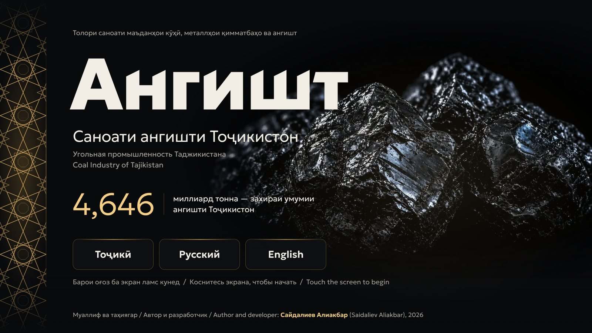
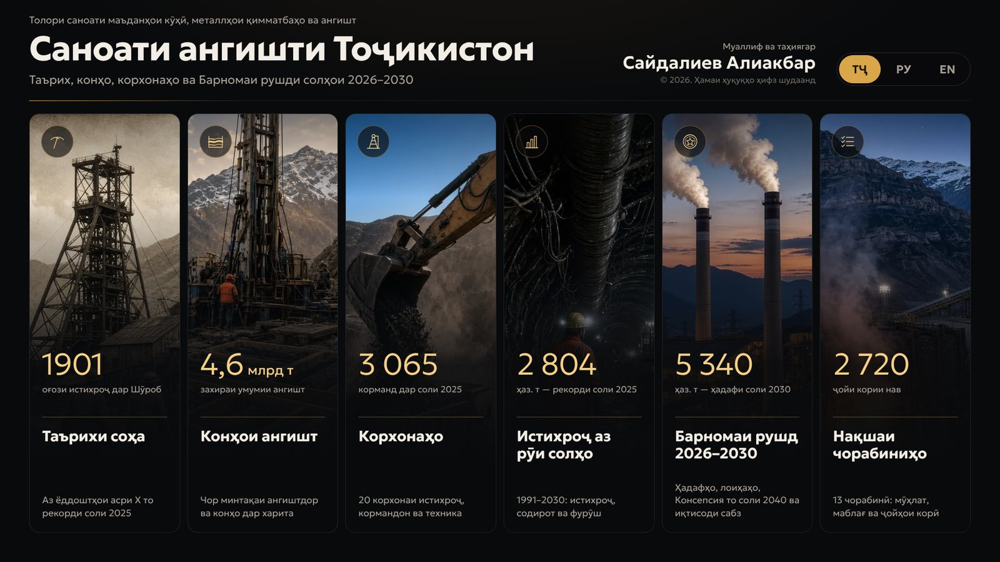
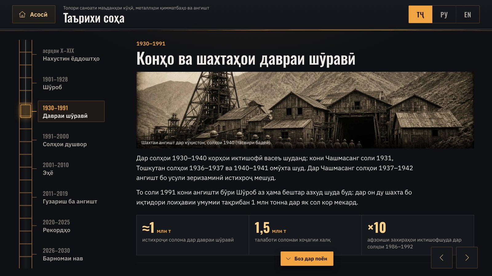
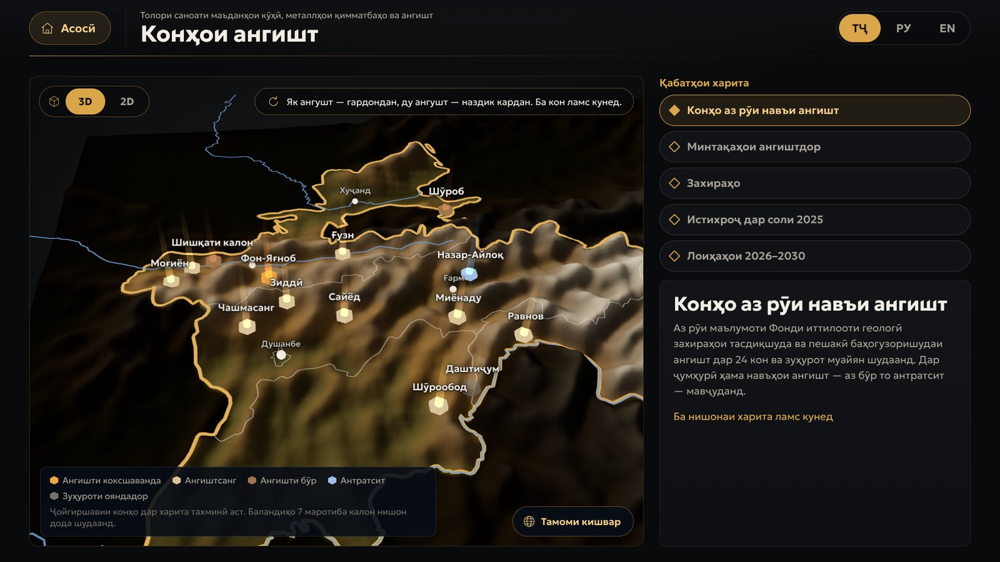
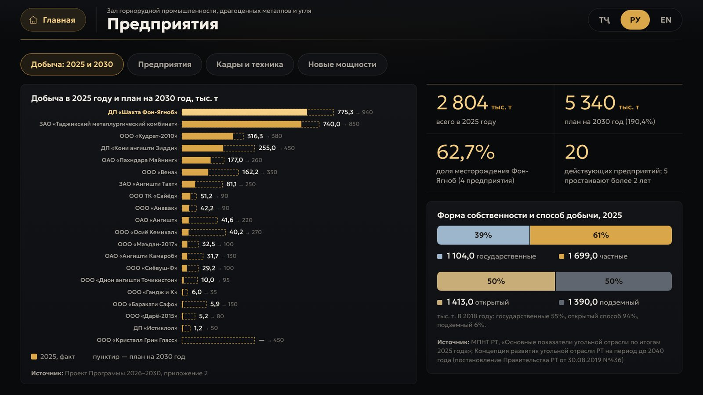
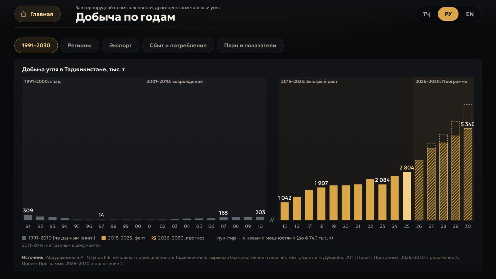
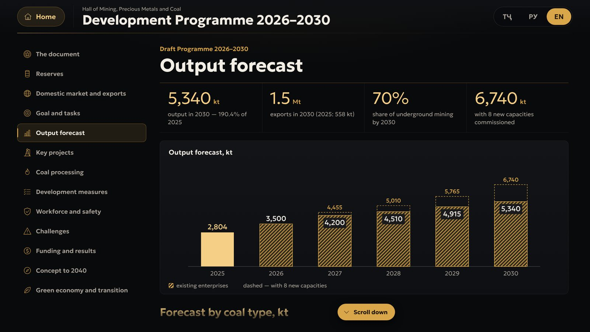
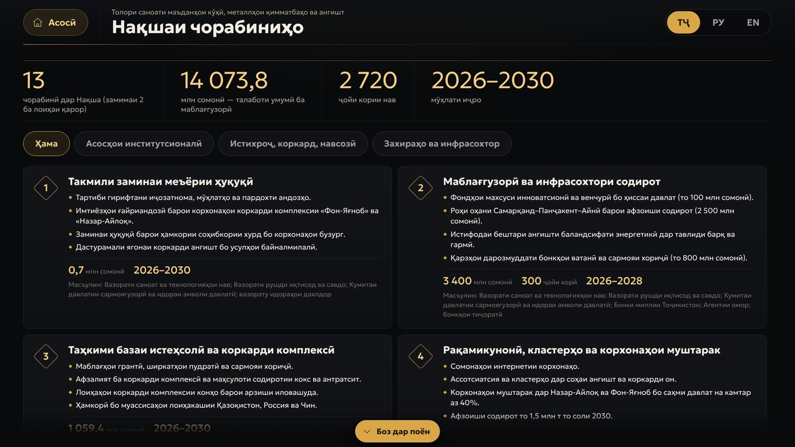
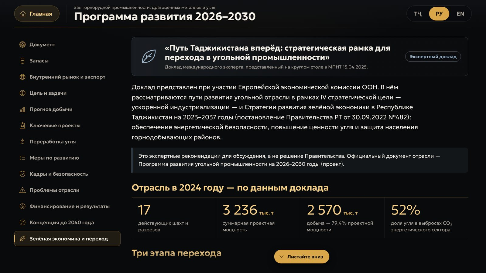

# Саноати ангишти Тоҷикистон · Угольная промышленность Таджикистана · Coal Industry of Tajikistan

**Интерактивный киоск зала горнорудной промышленности, драгоценных металлов и угля** — история угольной отрасли Таджикистана, месторождения на карте, 20 угледобывающих предприятий, добыча с 1991 по 2030 год, проект Программы развития угольной промышленности Республики Таджикистан на 2026–2030 годы с Планом мероприятий и экспертный доклад о «зелёном» переходе отрасли (ЕЭК ООН, 2025).

**Муаллиф ва таҳиягар · Автор и разработчик · Author and developer: Сайдалиев Алиакбар (Saidaliev Aliakbar)**
© 2026. Ҳамаи ҳуқуқҳо ҳифз шудаанд · Все права защищены · All rights reserved

### ▶ [Открыть киоск · Барномаро кушоед](https://grounsr.github.io/coalmuseum/?kiosk)

## Как открыть во весь экран

Браузеры не разрешают сайту включать полноэкранный режим сам по себе — только после действия посетителя. Поэтому:

- **Первое касание экрана** (или любая клавиша) сразу разворачивает киоск во весь экран — и по ссылке, и из файла.
- **Ссылка для музея:** `https://grounsr.github.io/coalmuseum/?kiosk` — если полный экран случайно закрыли, он вернётся при следующем касании.
- **Без касания вообще — как приложение.** На Android откройте ссылку в Chrome → меню ⋮ → «Установить приложение» («Добавить на главный экран»). Значок «Ангишт» запускает киоск сразу во весь экран, без адресной строки, и после первого открытия работает даже без интернета.
- **Киоск-браузер:** в Fully Kiosk Browser укажите ссылку стартовой страницей и включите полноэкранный режим. На Windows: `chrome.exe --kiosk "https://grounsr.github.io/coalmuseum/?kiosk"`.

---

## Разделы · Бахшҳо · Sections

| | Тоҷикӣ | Русский | English |
|---|---|---|---|
| 1 | **Таърихи соҳа** — аз асри X то Барномаи нав, 8 давра | **История отрасли** — от X века до новой Программы, 8 периодов | **History of the industry** — from the 10th century to the new Programme, 8 periods |
| 2 | **Конҳои ангишт** — 14 кон, навъҳои ангишт, захираҳо, минтақаҳо, лоиҳаҳо | **Месторождения** — 14 месторождений, виды угля, запасы, регионы, проекты | **Coal deposits** — 14 deposits, coal types, reserves, regions, projects |
| 3 | **Корхонаҳо** — 20 корхона: истихроҷ 2025 ва 2030, кадрҳо, техника | **Предприятия** — 20 предприятий: добыча 2025 и 2030, кадры, техника | **Enterprises** — 20 companies: output 2025 and 2030, workforce, machinery |
| 4 | **Истихроҷ аз рӯи солҳо** — 1991–2030, минтақаҳо, содирот, фурӯш | **Добыча по годам** — 1991–2030, регионы, экспорт, сбыт | **Output by year** — 1991–2030, regions, exports, sales |
| 5 | **Барномаи рушд 2026–2030** — 13 бахш, Консепсия то соли 2040 ва иқтисоди сабз | **Программа развития 2026–2030** — 13 разделов, Концепция до 2040 года и зелёная экономика | **Development Programme 2026–2030** — 13 sections, the Concept to 2040 and the green economy |
| 6 | **Нақшаи чорабиниҳо** — 13 чорабинӣ, маблағ, ҷойҳои корӣ, муҳлатҳо | **План мероприятий** — 13 мероприятий, финансирование, рабочие места, сроки | **Action Plan** — 13 measures, funding, jobs, timing |

| | |
|---|---|
|  |  |
|  |  |
|  |  |
|  |  |

## Особенности

- Три языка: таджикский (по умолчанию), русский и английский; отраслевая терминология (категории запасов A+B+C₁, C₂, марки углей, открытый и подземный способ добычи).
- Оформление «Галерея» по проекту зала: антрацит, золотые жилы в породе, свет шахтных фонарей, синяя подсвеченная карта и золотой гирих, как резные экраны музея.
- Шрифт Geologica встроен в файл, все таджикские буквы (Ҷ Ӯ Ҳ Ғ Қ Ӣ) поддерживаются.
- Работает без интернета — один файл `index.html` со встроенными шрифтами и изображениями.
- Сенсорный экран 32″, 1920×1080 и 4K: интерфейс масштабируется автоматически; анимация рассчитана на Android-плееры с 2 ГБ памяти.
- Режим киоска: заставка, автовозврат к началу через 2 минуты без касаний, защита от случайного выхода.

## Источники данных

- Проект Программы развития угольной промышленности Республики Таджикистан на 2026–2030 годы и План мероприятий (МПНТ РТ, 2026).
- Концепция развития угольной отрасли Республики Таджикистан на период до 2040 года (постановление Правительства РТ от 30.08.2019 №436).
- МПНТ РТ: основные показатели угольной отрасли по итогам 2025 года; сведения об экспорте угля за 2020–2026 годы.
- Абдурахимов Б.А., Охунов Р.В. «Угольная промышленность Таджикистана: сырьевая база, состояние и перспективы развития». Душанбе, 2011.
- Маршалл Дж. С. «Путь Таджикистана вперёд: стратегическая рамка для перехода в угольной промышленности», контракт ООН №2500372801, 10.03.2025; программа круглого стола в МПНТ с участием ЕЭК ООН, 15.04.2025. Рекомендации доклада — экспертные, а не решение Правительства.

## Авторское право

Код программы защищён и зашифрован. Разрешён только просмотр опубликованной страницы и демонстрация в экспозиции. Копирование, изменение, вскрытие защиты и использование в других проектах без письменного разрешения автора запрещены — см. [LICENSE](LICENSE).

По правилам GitHub публичный репозиторий можно просматривать и форкать внутри GitHub; это не даёт права использовать программу где-либо ещё.

Идентификатор сборки · Build ID: `SA-CL-2026-E8822F-C7F1DE`

**© 2026 Сайдалиев Алиакбар (Saidaliev Aliakbar). All rights reserved.**
